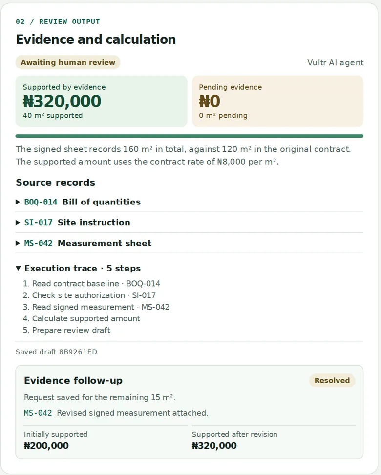

# Variation Desk

Variation Desk helps construction teams review claims for extra work against the contract, signed site instructions, and measured quantities. Each review produces a draft with the supported amount, the evidence still needed, and a trace a reviewer can inspect before making a payment decision.

[Open the live demo](http://64.177.53.137/) · Vultr Agent Rush 2026 · Powering the Future of Work

## Try the sample claim

The contractor claims **40 m² of additional paving at ₦8,000 per m²**. The bill of quantities covers 120 m², and the site instruction authorizes up to 40 m² of extra work.

1. Select **Initial measurement** and click **Review claim**. The signed sheet shows 145 m² in total. The review supports 25 m² (**₦200,000**) and flags 15 m² (**₦120,000**) as pending evidence.
2. Open the source records and the execution trace to see which documents and calculations produced the result.
3. Click **Request evidence**, then **Attach revised sample measurement** and **Review revised claim**. The revised signed sheet shows 160 m². The review supports all 40 m² (**₦320,000**) and keeps both drafts linked to the same request.



The public demo uses fictional records. The attachment step selects the supplied revised measurement. A reviewer makes the final decision.

## How the review works

| Component | Responsibility |
| --- | --- |
| **Vultr Cloud Compute** | An Ubuntu VM runs the Next.js web application and review API in Docker. |
| **Vultr Serverless Inference** | GLM-5.2 uses tools to retrieve the bill of quantities, site instruction, and measurement, then requests the calculation and draft. |
| **Review backend** | Validates the records and calculates supported quantities using the measured excess, authorized limit, claimed quantity, and contract rate. |
| **SQLite** | Stores drafts, evidence requests, and their revisions in a persistent Docker volume. |

## Run locally

Requires **Node.js 24 or later**.

```bash
npm ci
npm test
npm run dev
```

Open [localhost:3000](http://localhost:3000). The local app runs in **Rules preview** by default. To use the live agent, set `VULTR_INFERENCE_API_KEY` in the server environment before starting the app.

| Environment variable | Purpose |
| --- | --- |
| `VULTR_INFERENCE_API_KEY` | Serverless Inference subscription key. Set this server-side to enable agent reviews. |
| `VULTR_INFERENCE_MODEL` | Model override. Defaults to `glm-5.2`. |
| `DATABASE_PATH` | SQLite path. Defaults to `./data/variation-desk.sqlite` locally. |

`npm test` checks the sample calculations, validation of signed records and matching work items, and the agent tool sequence with a mocked inference response.

## Deploy on Vultr

1. Provision an Ubuntu 24.04 Cloud Compute VM with at least 2 GB RAM and a public IPv4 address. Allow inbound TCP port 80 if you use a firewall group.
2. Clone this repository onto the VM and run the installer from the project directory.

   ```bash
   sudo bash deploy-vultr.sh install
   ```

3. Create a Vultr Serverless Inference subscription and copy its inference key. Run the following command and enter the key at the hidden prompt.

   ```bash
   sudo bash deploy-vultr.sh configure-inference
   ```

4. Open the VM's public IPv4 address. The header should show **Vultr AI agent**. Run the initial case to verify the connection.

The installer runs the app on port 80 and stores SQLite data in the `variation-desk-data` Docker volume. The public demo caps model-driven reviews at 60 runs per UTC day.

## License

[MIT](LICENSE)
